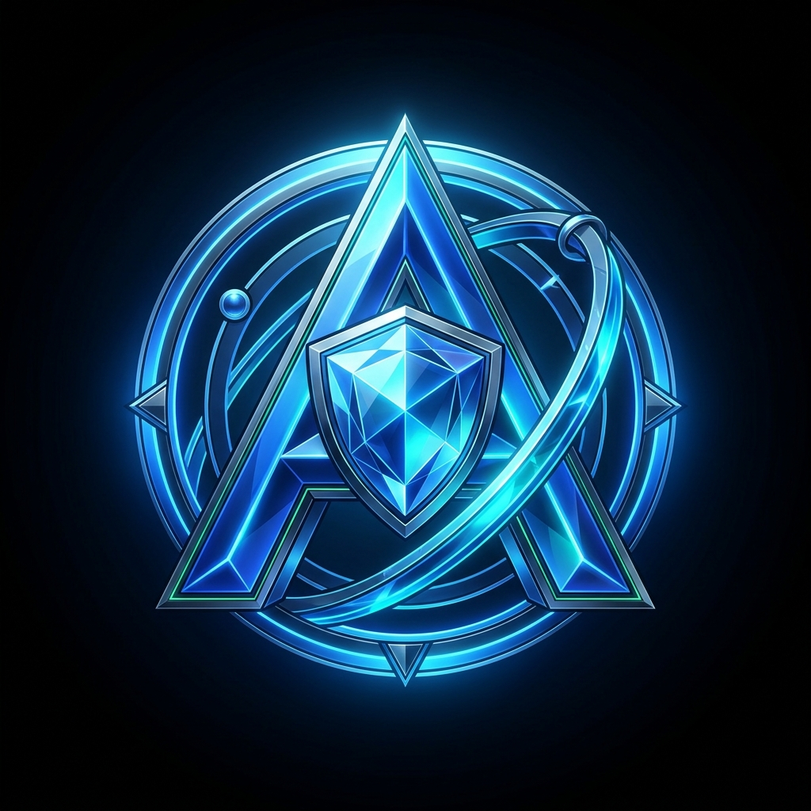

# Atlas AI — Autonomous Financial Operations OS

<p align="center">
  
</p>

<p align="center">
  <strong>A secure 24/7 multi-agent operating system that monitors markets, analyzes order flow, manages portfolio risk, communicates omnichannel, and executes broker actions strictly under explicit policy and human approval controls.</strong>
</p>

<p align="center">
  <a href="#system-architecture"></a>
  <a href="#event-driven-architecture"></a>
  <a href="#protocols-mcp--a2a"></a>
  <a href="#security--vaulting"></a>
  <a href="#supported-broker-integrations"></a>
  <a href="LICENSE"></a>
</p>

---

## Executive Overview

**Atlas AI** is not merely another trading bot or signal script. It is an **autonomous financial operating system (OS)** designed from first principles for institutional-grade quantitative risk governance.

In traditional algorithmic platforms, trading strategies, risk calculations, and exchange execution keys are tangled into a single process. If the model hallucinates or market volatility surges, capital is at immediate risk.

**Atlas AI solves this through strict Zero-Trust Segregation of Duties:**
- Strategy agents have **zero access** to broker credentials.
- The manager agent **cannot execute** orders.
- The Risk Agent maintains an **unbendable constitutional Hard Veto**.
- High-risk trades require **cryptographic Human Approval** (via Web Cockpit, WhatsApp, or Telegram).
- Only the isolated **Execution Agent** holds exchange API adapters.

---

## System Architecture

```text
                               ATLAS AI
                       (Autonomous Operations OS)
                                  │
                            ┌─────▼─────┐
                            │  Manager  │ (COORDINATE · 0 Broker Access)
                            │   Agent   │
                            └─────┬─────┘
                                  │
        ┌─────────────────────────┼─────────────────────────┐
        ▼                         ▼                         ▼
   Market Agent              News Agent                 Risk Agent
  (READ: L2 & CVD)         (READ: Calendars)       (ANALYZE & HARD VETO)
        │                         │                         │
        └─────────────────────────┼─────────────────────────┘
                                  ▼
                            Decision Agent
                         (ANALYZE: Expected Value)
                                  │
                             Critic Agent
                       (CRITIQUE: Downside Risks)
                                  │
                         ┌────────▼────────┐
                         │  Policy / Risk  │ (VaR & Margin Checks)
                         │     Engine      │
                         └────────┬────────┘
                                  │
                        Human Approval Gate
                     (Web / WhatsApp / Telegram)
                                  │
                           Execution Agent
                        (EXECUTE ONLY · KMS Vault)
                                  │
                         Trading Integration
                                  │
              ┌───────────────────┼───────────────────┐
              ▼                   ▼                   ▼
           Binance              OANDA                MT5
        (Spot/Futures)      (Forex/Metals)      (ZeroMQ Bridge)
```

---

## The 8 Flagship Pillars

### 1. Role-Based Agent Permissions (Least Privilege)
Every node in the LangGraph state graph operates within a strictly sandboxed permission boundary:
- `Market Agent` &rarr; `READ ONLY` (L2 depth, orderbook imbalance, CVD taker pressure)
- `News Agent` &rarr; `READ / ANALYZE` (FOMC/CPI releases, volatility embargoes)
- `Risk Agent` &rarr; `ANALYZE & HARD VETO` (Monitors 99% portfolio VaR, margin usage, daily drawdown)
- `Decision Agent` &rarr; `ANALYZE` (Synthesizes mathematical setups with positive Expected Value $\text{EV} > 0$ and $1:2$ Risk-to-Reward)
- `Critic Agent` &rarr; `CRITIQUE` (Acts as devil's advocate stress-testing downside stop invalidation)
- `Execution Agent` &rarr; `EXECUTE ONLY` (The sole entity holding broker API keys, gated behind verified human signatures)

### 2. Cryptographic Human Approval Gate
When the swarm synthesizes a high-risk trade proposal, the workflow pauses at an asynchronous checkpoint:
```text
AI Proposes Trade ──► Risk Validation ──► Policy Check ──► Human Approval Gate ──► Execution
                                                                    ▲
                                          [Web Modal / WhatsApp "YES" / Telegram]
```
No order can reach the exchange until an authorized operator verifies the bracket (Entry, Invalidation SL, Take-Profit TP) with a signed approval ticket.

### 3. 24/7 Event-Driven Kafka Pipeline
Atlas AI replaces polling with an asynchronous event stream built on **Apache Kafka / Redpanda**:
```text
Market Tick / L2 Event
         │
         ▼
  Kafka Event Bus  ──►  Agent Swarm Graph  ──►  Risk Verification  ──►  Execution Alert
```
Sub-10ms event topics decouple orderbook ingestion from LLM deliberation loops.

### 4. Persistent Checkpointed State Graphs
Powered by **LangGraph** with PostgreSQL and Redis state checkpointers. If a server container, worker node, or cloud host restarts mid-deliberation, `recover_workflow()` restores the state graph from the exact active node without losing market context or duplicating orders.

### 5. Model Context Protocol (MCP)
Atlas AI implements Anthropic's **Model Context Protocol (MCP)**. Tools (orderbook snapshots, CVD calculations, news calendars, portfolio telemetry) are defined as standard MCP schemas on `atlas-mcp-core`. Agents dynamically discover, validate, and invoke tools across the workspace.

### 6. Agent-to-Agent (A2A) Protocol
Adheres to the open **[A2A Protocol specification](https://a2a-protocol.org/)**. Atlas AI can publish signed `A2ADelegationRequest` messages to remote external specialist nodes (e.g., On-Chain Whale Trackers, Implied Volatility Surface quants) and verify responses with asymmetric cryptography.

### 7. AI Trading Journal (7-Part Immutable Audit Trail)
Every decision is recorded in an immutable audit ledger:
$$\text{Market State} \longrightarrow \text{Agent Observations} \longrightarrow \text{Decision} \longrightarrow \text{Risk Assessment} \longrightarrow \text{Approval Token} \longrightarrow \text{Execution} \longrightarrow \text{Outcome}$$
Includes Maximum Favorable Excursion (MFE), Maximum Adverse Excursion (MAE), and agent vote records.

### 8. Historical Scenario Crisis Evaluation
The built-in evaluation harness stress-tests the multi-agent graph against black-swan market shocks:
- **FTX Liquidity Collapse (Nov 2022)** &rarr; Verifies automatic risk gate trip & halt.
- **SVB De-peg Crisis (Mar 2023)** &rarr; Verifies stablecoin exposure liquidation.
- **LUNA Hyperinflation (May 2022)** &rarr; Verifies instant circuit breaker activation.

---

## Monorepo Layout

```text
atlas-ai-trading-os/
├── apps/
│   ├── api/                 # FastAPI modular monolith backend (Python 3.12)
│   │   └── src/atlas_api/
│   │       ├── modules/agents/        # LangGraph 7-node swarm & state graphs
│   │       ├── modules/marketdata/    # L2 orderbook feeds, CVD delta engine
│   │       ├── modules/trading/       # Broker connectivity & order lifecycle
│   │       ├── modules/automation/    # Smart stops, auto-breakeven, bot loops
│   │       ├── modules/auth/          # ES256 JWT, Argon2id, RBAC security
│   │       └── modules/credentials/   # AES-256-GCM KMS envelope vault
│   └── web/                 # Next.js 15 App Router frontend (TypeScript)
│       └── src/
│           ├── app/
│           │   ├── page.tsx           # Flagship Home & Landing Page
│           │   ├── cockpit/           # 24/7 Trading Cockpit Dashboard
│           │   ├── architecture/      # Technical Blueprint, MCP & A2A RFC
│           │   ├── pricing/           # Institutional Tiers & FAQ
│           │   ├── security/          # KMS Envelope Encryption & Vaulting
│           │   └── docs/              # Developer Documentation & API Specs
│           └── components/            # Sober, high-precision institutional UI
├── shared/
│   ├── atlas_ai/            # Shared MCP tool server & A2A protocol contracts
│   ├── atlas_core/          # Database, crypto, vault, timing, rate-limiting
│   ├── atlas_events/        # Kafka / Redpanda event schemas & outbox relay
│   └── atlas_venues/        # Broker adapters (Binance, OANDA, MT5, Bybit)
├── services/
│   ├── worker/              # Celery background workers & Kafka consumers
│   ├── scheduler/           # Celery Beat cron tasks & venue health probes
│   └── mt5-bridge/          # ZeroMQ bridge for MetaTrader 5 integration
└── infra/
    ├── docker/              # Docker Compose for PostgreSQL, Redis, Kafka
    └── k8s/                 # Kubernetes manifests for cloud deployment
```

---

## Quickstart

### Prerequisites
- **Python 3.12+** with [`uv`](https://github.com/astral-sh/uv)
- **Node.js 22 LTS** with `npm` / `pnpm`
- **Docker & Docker Compose** (for Kafka, Redis, and PostgreSQL)

### 1. Clone & Install Dependencies
```bash
git clone https://github.com/your-username/atlas-ai-trading-os.git
cd atlas-ai-trading-os

# Python virtual environment & dependencies
uv sync

# Web dependencies
npm --prefix apps/web install
```

### 2. Start Infrastructure Services
```bash
docker compose -f infra/docker/compose.yaml up -d
```
Starts:
- **PostgreSQL 16** with `pgvector` (`:5432`)
- **Redis 7** for real-time pub/sub (`:6379`)
- **Kafka / Redpanda** broker (`:9092`)

### 3. Launch Development Environment
```bash
# Terminal 1: Launch Backend API
uv run uvicorn atlas_api.main:create_app --factory --reload --port 8000

# Terminal 2: Launch Frontend Web Cockpit
npm --prefix apps/web run dev
```

Visit [`http://localhost:3000`](http://localhost:3000) to open the **Atlas AI Landing Page**, or navigate directly to [`http://localhost:3000/cockpit`](http://localhost:3000/cockpit) for the **Trading Cockpit**.

---

## Kafka Event Bus Topics

| Topic | Key | Message Payload | Description |
| :--- | :--- | :--- | :--- |
| `atlas.market.orderbook.v1` | `symbol` | `{ bids, asks, cvdDelta, timestamp }` | Sub-10ms raw L2 tick orderbook feed ingested by Market Agent |
| `atlas.macro.news.v1` | `eventId` | `{ event, impact, forecast, actual, embargo }` | Macroeconomic calendar events triggering volatility embargoes |
| `atlas.swarm.proposal.v1` | `proposalId` | `{ symbol, side, price, ev, rrRatio, agentVotes }` | Synthesized setup published for Risk Agent VaR verification |
| `atlas.execution.orders.v1` | `orderId` | `{ broker, symbol, side, qty, tpPrice, slPrice, token }` | Audited trade execution payload delivered exclusively to Execution Agent |

---

## Security & KMS Envelope Encryption

Atlas AI is strictly **non-custodial**:
1. Client API secrets are encrypted on-client using **AES-256-GCM** with 96-bit authenticated nonces.
2. Ephemeral Data Encryption Keys (DEK) are wrapped using customer-managed keys via **AWS KMS** or **GCP Cloud KMS**.
3. Plaintext API keys and broker secrets **never touch LLM prompts or external cloud logs**.
4. The **Emergency Flatten Kill Switch** instantly issues market-order liquidations across all active venues and locks the platform in `HALTED` state.

---

## Supported Broker Venues

| Venue | Asset Classes | Integration Method | Execution Latency |
| :--- | :--- | :--- | :--- |
| **Binance** | Crypto Spot & USD-M Futures | Direct REST & WebSocket Adapter | &lt; 25ms |
| **OANDA** | Forex & Precious Metals (XAU, XAG) | v20 REST Streaming API | &lt; 40ms |
| **MetaTrader 5** | Indices (US100, US500, GER40) & Stocks | ZeroMQ TCP IPC Bridge | &lt; 15ms |
| **Interactive Brokers** | US Equities & Options | IB TWS / Gateway API *(Roadmap)* | &lt; 35ms |

---

## License & Risk Disclaimer

Distributed under the **Apache License, Version 2.0**. See `LICENSE` for details.

> **Risk Disclosure:** Trading foreign exchange, cryptocurrencies, and derivatives on margin carries a high level of risk and may not be suitable for all investors. The high degree of leverage can work against you as well as for you. Before deciding to trade, you should carefully consider your investment objectives, level of experience, and risk appetite. Atlas AI OS enforces constitutional risk caps, but past performance does not guarantee future financial results.
